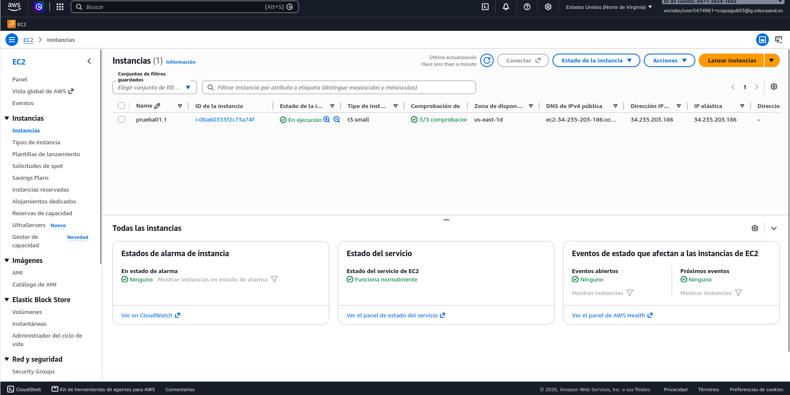
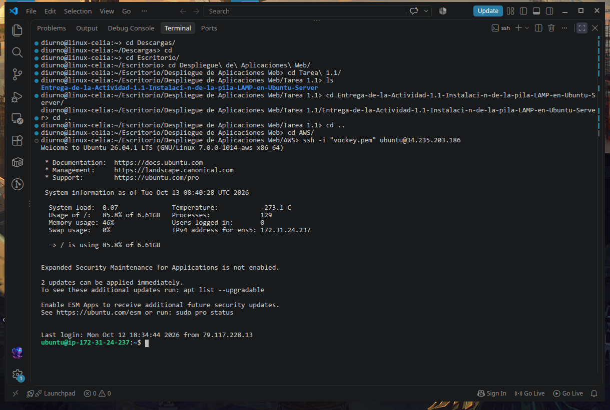
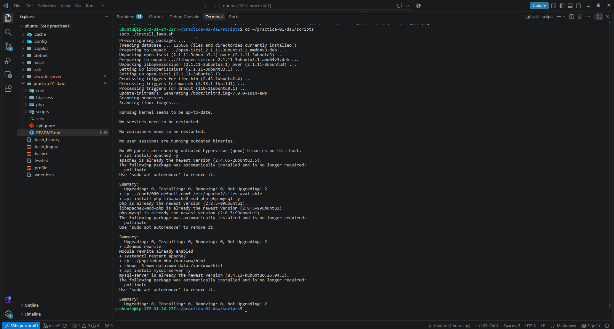
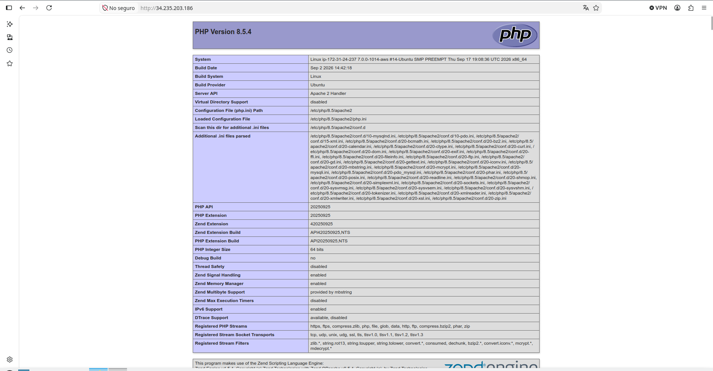
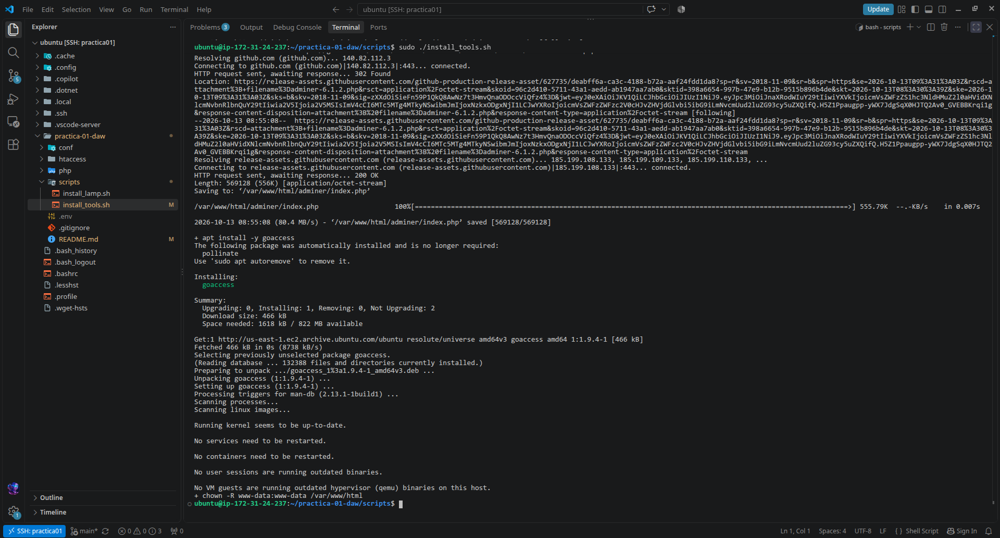
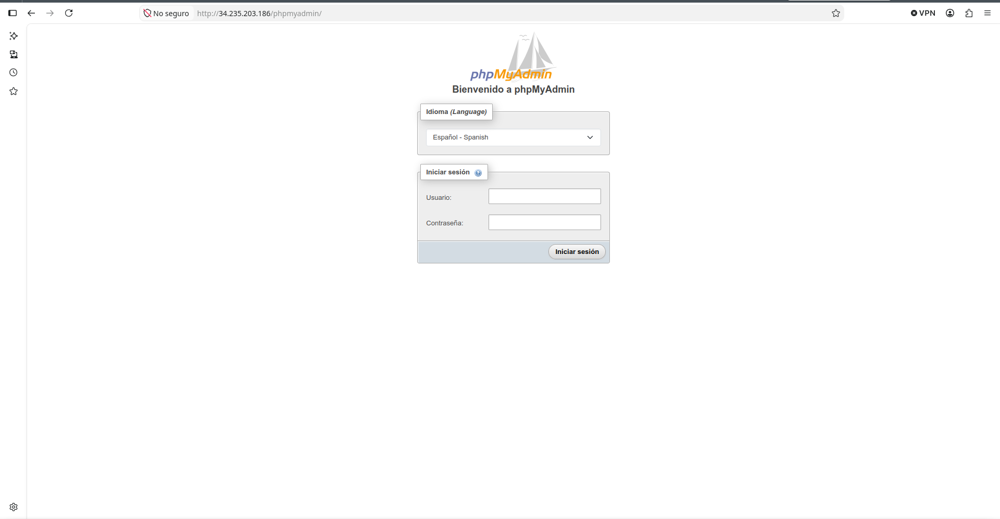
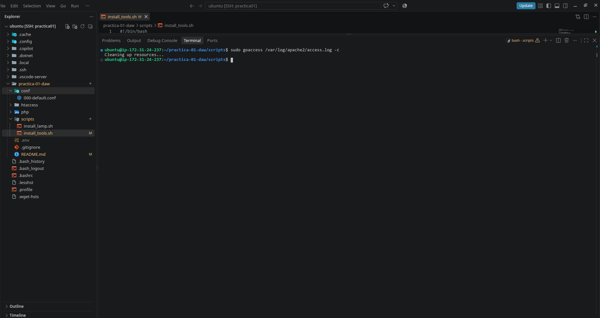
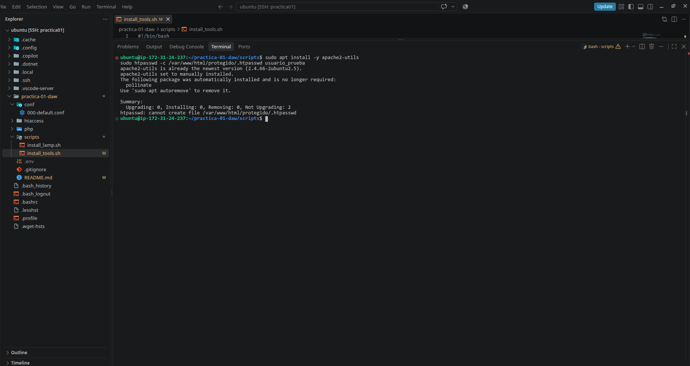
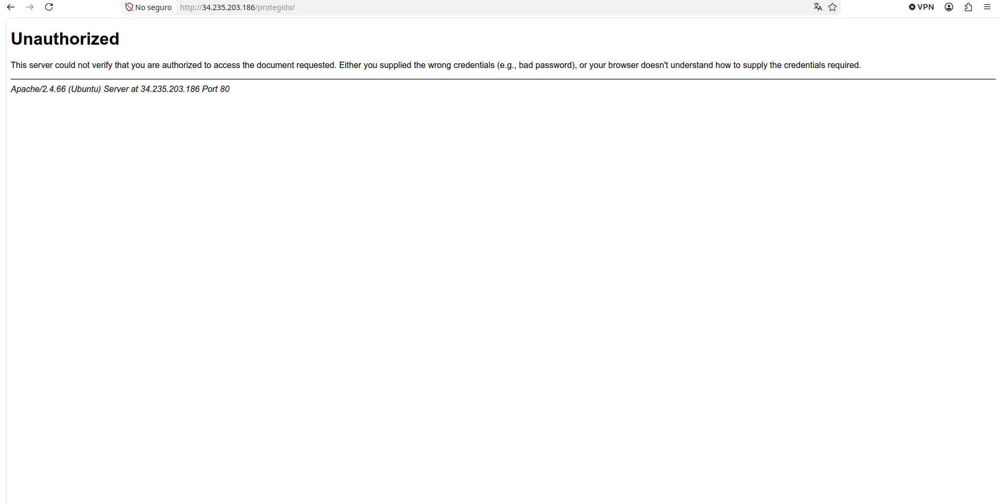

# Práctica 1.1: Instalación de la pila LAMP en una instancia de AWS y herramientas adicionales

---

## 1. Datos de la Infraestructura en AWS

Para la realización de esta práctica se ha provisionado una máquina virtual (instancia EC2) en la nube de Amazon Web Services utilizando los siguientes parámetros:

* **Nombre de la instancia:** `prueba01.1`
* **Tipo de instancia:** `t3.small` (8 vCPU, 8 GiB de RAM)
* **Sistema Operativo / AMI:** Ubuntu Server 22.04 LTS
* **Dirección IP pública / elástica:** `34.235.203.186`
* **Usuario de conexión SSH:** `ubuntu`
* **Clave de acceso:** `vockey.pem` (proporcionada por AWS Academy Learner Lab)
* **Reglas del Grupo de Seguridad:**
  * **SSH:** Protocolo TCP, Puerto `22`, Origen `0.0.0.0/0`
  * **HTTP:** Protocolo TCP, Puerto `80`, Origen `0.0.0.0/0`
  * **HTTPS:** Protocolo TCP, Puerto `443`, Origen `0.0.0.0/0`

  

---

## 2. Descripción de la Instalación de la Pila LAMP

La pila LAMP está compuesta por **Linux** (Ubuntu Server), **Apache HTTP Server**, **MySQL Server** y **PHP**. El proceso completo de aprovisionamiento e instalación se ha automatizado mediante scripts de Bash.

### 2.1. Pasos previos y Conexión
Una vez arrancado el laboratorio en AWS Academy y creada la instancia con la IP elástica `34.235.203.186`, nos conectamos por SSH utilizando la clave privada:

```bash
chmod 400 vockey.pem
ssh -i "vockey.pem" ubuntu@34.235.203.186
```




### 2.2. Script de Automatización de LAMP (install_lamp.sh)
El script actualiza los repositorios del sistema e instala de forma desatendida Apache, MySQL Server y PHP junto con sus módulos esenciales (libapache2-mod-php, php-mysql, php-cli y un largo etc.).

```bash
#!/bin/bash
export DEBIAN_FRONTEND=noninteractive

# Actualización del sistema
sudo apt update && sudo apt upgrade -y

# Instalación de Apache
sudo apt install -y apache2

# Instalación de MySQL Server
sudo apt install -y mysql-server

# Instalación de PHP y módulos necesarios
sudo apt install -y php libapache2-mod-php php-mysql php-cli php-curl php-gd php-mbstring php-xml php-zip

# Reinicio y habilitación de servicios
sudo systemctl restart apache2
sudo systemctl enable apache2
sudo systemctl restart mysql
sudo systemctl enable mysql
```



## 3. Instalación de Herramientas de Gestión y Monitorización


Para complementar la administración del servidor web y las bases de datos, se han instalado herramientas adicionales mediante el script install_tools.sh.
### 3.1. phpMyAdmin

phpMyAdmin se instala para permitir una gestión visual y sencilla de las bases de datos MySQL a través de la web.

Se configuran las dependencias y se enlaza el directorio de phpMyAdmin al entorno de Apache.



### 3.2. Adminer

Adminer es una alternativa ligera y en un único fichero PHP para la gestión de bases de datos, instalándose como complemento rápido de acceso web.
### 3.3. Analizador de Logs: GoAccess

GoAccess permite analizar en tiempo real los registros de acceso (access.log) del servidor Apache directamente desde la terminal o exportándolo a formato HTML para su visualización web.

Extracto del script de herramientas (install_tools.sh):

```bash
#!/bin/bash
# Instalación de phpMyAdmin de forma automatizada
sudo apt install -y phpmyadmin php-mbstring php-zip php-gd php-json php-curl

# Instalación de Adminer
sudo mkdir -p /var/www/html/adminer
sudo wget -O /var/www/html/adminer/index.php [https://www.adminer.org/latest.php](https://www.adminer.org/latest.php)

# Instalación de GoAccess
sudo apt install -y goaccess
```
---
## 4. Control de Acceso a un Directorio con .htaccess

Para restringir el acceso a determinadas rutas o directorios web del servidor Apache, se han habilitado los ficheros de configuración .htaccess.

  Modificamos la configuración por defecto de Apache (/etc/apache2/sites-available/000-default.conf) para permitir sobreescrituras en el directorio raíz /var/www/html.

  Creamos un fichero .htaccess protegido mediante credenciales cifradas con htpasswd.

```bash
AuthType Basic
AuthName "Área Restringida - Acceso Autorizado"
AuthUserFile /var/www/html/.htpasswd
Require valid-user
```
  
